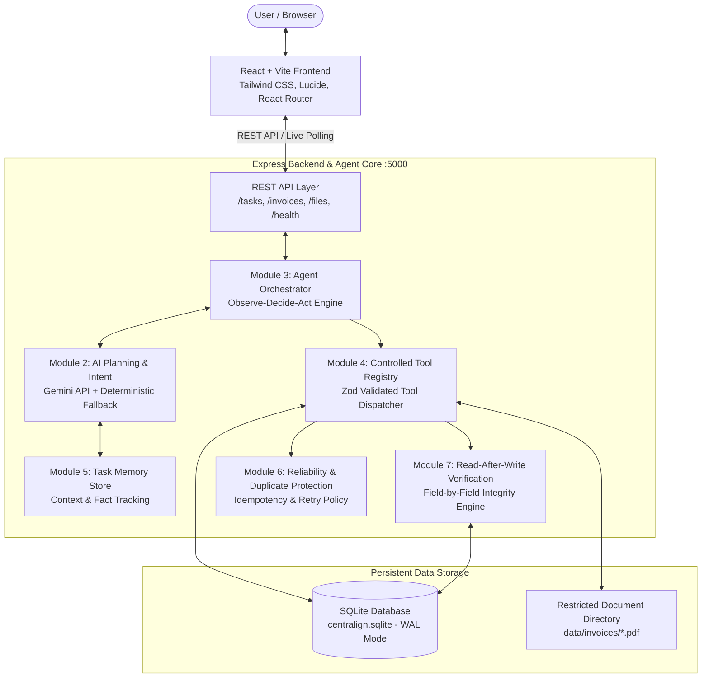
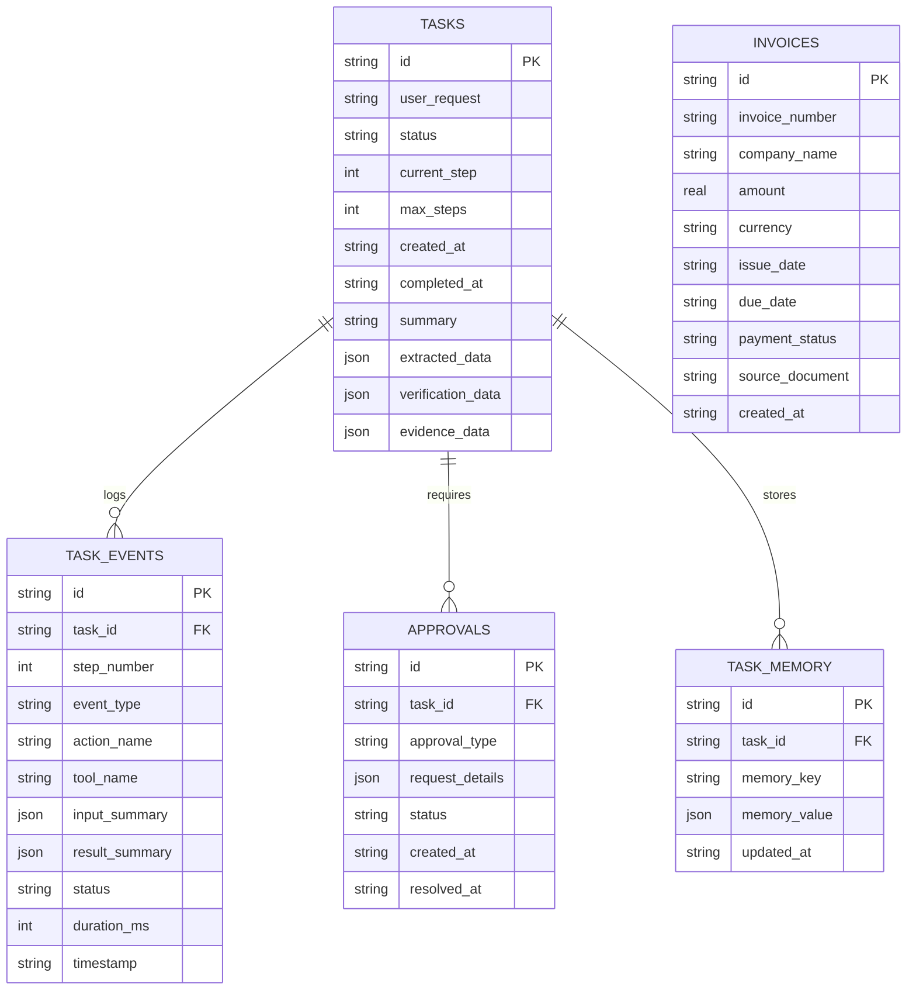
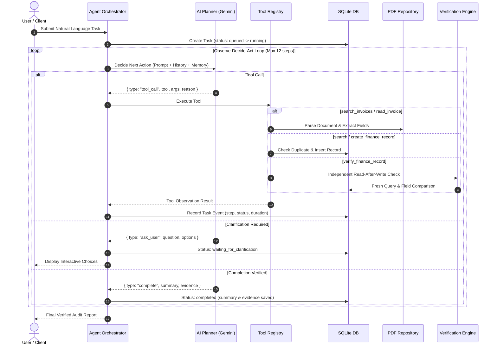

# CentrAlign AI — Autonomous AI Task Worker

An enterprise-grade, fully functional full-stack web application featuring an autonomous AI task worker that can understand natural-language goals, plan and execute multi-step workflows, interact with application databases and PDF files, observe outcomes, recover from transient failures, enforce strict duplicate protection, independently verify results with read-after-write validation, and report verified completion.

---

## 📑 Table of Contents

- [1. Executive Summary](#1-executive-summary)
- [2. System Architecture](#2-system-architecture)
- [3. Eight Core Backend Modules](#3-eight-core-backend-modules)
- [4. Visual Design & User Interface](#4-visual-design--user-interface)
- [5. Technology Stack](#5-technology-stack)
- [6. Setup & Installation](#6-setup--installation)
- [7. Database Schema & Entity Relationships](#7-database-schema--entity-relationships)
- [8. Autonomous Execution Engine](#8-autonomous-execution-engine)
- [9. Demonstration Scenarios](#9-demonstration-scenarios)
- [10. Testing Suite](#10-testing-suite)
- [11. AI Model Configuration & Hallucination Controls](#11-ai-model-configuration--hallucination-controls)
- [12. Design Decisions, Assumptions & Limitations](#12-design-decisions-assumptions--limitations)

---

## 1. Executive Summary

Enterprise automation typically breaks down when LLMs hallucinate tool outputs, guess mathematical calculations, or claim success without checking whether database operations actually persisted.

**CentrAlign AI** solves this through:
1. **Autonomous Observe-Decide-Act Execution Loop**: The worker plans decisions dynamically based on real tool observations, bounded by a strict state machine.
2. **Deterministic Offloading**: Calculations, date comparisons, and database transactions are executed in deterministic code—never delegated to LLM hallucinations.
3. **Module 7 Read-After-Write Independent Verification**: The worker never marks a financial write complete without performing a fresh, independent query to SQLite comparing expected vs. actual database values.
4. **Idempotency & Duplicate Protection**: Multi-key compound checks prevent duplicate financial entries.
5. **Transient Failure Recovery**: Automatically detects timeouts/transient errors and performs bounded retries.

---

## 2. System Architecture



---

## 3. Eight Core Backend Modules

| Module | Name | Implementation & Responsibilities |
|---|---|---|
| **Module 1** | **User Interface & Task Input** | Natural language prompt submission, live status polling, clarification question modals, approval checkpoints, and verified audit reports. |
| **Module 2** | **AI Task Understanding & Planning** | Gemini 1.5 Flash structured JSON generation (`@google/generative-ai`), temperature bounds (0.1 planning, 0.0 extraction), and deterministic fallback planner for guaranteed uptime. |
| **Module 3** | **Agent Orchestration** | 10-state machine (`queued`, `planning`, `running`, `waiting_for_approval`, `waiting_for_clarification`, `verifying`, `completed`, `partially_completed`, `failed`, `cancelled`), maximum 12 action bounds, cancellation tokens. |
| **Module 4** | **Controlled Tool Registry** | Zod-validated tool definitions: `search_invoices`, `read_invoice`, `search_finance_records`, `create_finance_record`, `verify_finance_record`. |
| **Module 5** | **Memory & Context Management** | Persistent SQLite-backed task memory store (`task_memory`), maintaining discovered facts, extracted invoice headers, and execution history. |
| **Module 6** | **Reliability & Error Handling** | Error taxonomy classification (transient vs permanent), duplicate prevention logic, and bounded exponential retries. |
| **Module 7** | **Verification & Evidence** | Independent read-after-write verification that queries the database fresh and verifies field matches before allowing a `complete` status. |
| **Module 8** | **Reporting & Audit Logging** | Chronological event stream (`task_events`), step timing in milliseconds, request/response JSON payloads, and downloadable execution logs. |

---

## 4. Visual Design & User Interface

The application replicates the visual enterprise design from the reference images:
* **Dark Navy Sidebar (`#142B4A`)**: Persistent navigation with CentrAlign AI branding and live AI worker status badge.
* **Palette**: Primary Navy (`#142B4A`), Action Blue (`#2563EB`), Success Green (`#15803D`), Warning Amber (`#D97706`), Error Red (`#DC2626`), Background (`#F8FAFC`).
* **All Eight Pages Fully Implemented**:
  1. **Home Dashboard (`/`)**: High-level stats, prompt launcher with 4 scenario buttons, recent executions table.
  2. **New Task / Chat (`/new-task`)**: Interactive conversation interface with clarification option buttons and approval controls.
  3. **Live Execution Viewer (`/execution/:id`)**: Matches the visual reference: metrics bar (Total Steps, Errors, Duration, Status), two-column layout with Steps timeline (request/response JSON) on the left, and interactive **Execution Flowchart graph** and terminal console on the right.
  4. **Finance Application (`/finance`)**: Real SQLite invoice table, search, status filters (Unpaid, Paid, Overdue), stats banner, and "Add Invoice" modal.
  5. **Task Completion Summary (`/tasks/:id/summary`)**: Read-after-write verification checklist, extracted fields, field comparison matrix, and evidence links.
  6. **Task History (`/history`)**: Full searchable and filterable table of all executions.
  7. **Files (`/files`)**: Restricted document repository with metadata inspection modal and direct PDF preview.
  8. **Settings (`/settings`)**: AI model config, execution limits, tool registry status, and **Scenario 5 failure simulation switch**.

---

## 5. Technology Stack

* **Frontend**: React 18, Vite 6, TypeScript, Tailwind CSS, Lucide Icons, React Router 7, Axios, Canvas Confetti.
* **Backend**: Node.js v24, Express, TypeScript, Zod, `node:sqlite` (`DatabaseSync` in WAL mode).
* **Document Processing**: `pdf-lib` (PDF generation & Document Info Dictionary inspection).
* **AI Model**: Google Gemini (`@google/generative-ai`) with structured JSON schema.
* **Testing**: Vitest test runner.

---

## 6. Setup & Installation

### Prerequisites
* **Node.js**: v20+ or v24+
* **npm**: v10+

### Step 1: Clone and Install
```bash
# In project root
npm --prefix server install
npm --prefix client install
```

### Step 2: Configure Environment Variables
Create a `.env` file in the root folder or in `server/`:
```env
PORT=5000
GEMINI_API_KEY=your_gemini_api_key_here
```
*(Note: If `GEMINI_API_KEY` is not provided or network is offline, the autonomous worker automatically activates its deterministic fallback planner, ensuring 100% demonstration reliability).*

### Step 3: Seed Database and Generate Sample Invoices
```bash
npm run seed
```
This generates authentic sample invoice PDFs in `data/invoices/` and initializes SQLite tables with realistic initial records.

### Step 4: Run Application
```bash
# Terminal 1: Run Backend Server
npm --prefix server run dev

# Terminal 2: Run Frontend Client
npm --prefix client run dev
```

* **Frontend Client**: `http://localhost:3000`
* **Backend API**: `http://localhost:5000`
* **API Health Check**: `http://localhost:5000/api/health`

---

## 7. Database Schema & Entity Relationships



---

## 8. Autonomous Execution Engine



---

## 9. Demonstration Scenarios

### Scenario 1: Successful Invoice Task (Happy Path)
* **Prompt**: `"Find the latest invoice from ABC Technologies, extract the amount and due date, add it to the finance system, and confirm completion."`
* **Autonomous Execution Steps**:
  1. `search_invoices`: Locates available invoices from ABC Technologies (`INV-1001` and `INV-1002`). Orders by date descending (`INV-1002` is latest).
  2. `read_invoice`: Parses `INV-1002-ABC_Technologies.pdf`. Extracts amount ($18,750.50 USD) and due date (`2026-11-01`).
  3. `search_finance_records`: Checks whether `INV-1002` is already recorded in the finance system (0 matches).
  4. `create_finance_record`: Writes record to SQLite with duplicate protection.
  5. `verify_finance_record`: Performs independent read-after-write verification on the saved record.
  6. `complete`: Reports verified completion with field matching evidence.

### Scenario 2: Unpaid Invoices Calculation (Deterministic Math)
* **Prompt**: `"Find all unpaid invoices from Global Corp and tell me their total amount."`
* **Autonomous Execution Steps**:
  1. `search_finance_records`: Queries SQLite for Global Corp invoices where `payment_status = 'unpaid'`.
  2. Captures records: `INV-2001` ($9,200.00) and `INV-2002` ($14,400.00).
  3. Deterministically calculates sum ($23,600.00 USD) in code—zero mathematical hallucination.
  4. `complete`: Reports count, invoice list, and verified total outstanding sum.

### Scenario 3: Duplicate Invoice Ingestion (Idempotency Protection)
* **Prompt**: `"Add invoice INV-1001 to the finance system."`
* **Autonomous Execution Steps**:
  1. `search_finance_records`: Checks database for `INV-1001`.
  2. Detects exact match: `INV-1001` is already present for ABC Technologies (`inv_abc_1001`).
  3. Prevents duplicate write.
  4. `complete`: Reports duplicate detected and confirms duplicate creation was safely avoided.

### Scenario 4: Ambiguous Request (Human-in-the-Loop Clarification)
* **Prompt**: `"Add the latest invoice."`
* **Autonomous Execution Steps**:
  1. Evaluates request: Multiple companies exist in repository without specification.
  2. Status transitions to `waiting_for_clarification`.
  3. Emits question: *"Multiple companies exist in the repository (ABC Technologies, Global Corp, Acme Solutions, Innovate Ltd). Which company's latest invoice would you like me to process?"*
  4. User clicks an option (e.g., *ABC Technologies*).
  5. Worker resumes and safely processes the clarified company.

### Scenario 5: Temporary Gateway Failure Recovery
* **How to trigger**: Go to **Settings** (`/settings`) and toggle **Scenario 5: Temporary Failure Simulation** to **ON**.
* **Prompt**: `"Find the latest invoice from Acme Solutions, extract the details, add it to the finance system, and confirm completion."`
* **Autonomous Execution Steps**:
  1. Invoices searched and `INV-3001` parsed.
  2. First write attempt triggers simulated `HTTP 504 Gateway Timeout` (`FINANCE_GATEWAY_TIMEOUT`).
  3. Orchestrator classifies error as transient, verifies retry count <= 2.
  4. Safe retry #1 executed -> succeeds!
  5. Independent read-after-write verification performed on the recovered record.
  6. Verified completion reported.

---

## 10. Testing Suite

The project includes an automated test suite executed with Vitest:

```bash
npm run test
```

### Verified Tests:
* ✓ `search_invoices`: Sorts results newest first.
* ✓ `read_invoice`: Parses invoice fields, amount, currency, and dates accurately.
* ✓ `read_invoice`: Flags missing due dates on edge-case documents (`INV-MISSING-DUE-Innovate_Ltd.pdf`).
* ✓ `read_invoice`: Rejects corrupted test documents safely (`CORRUPTED_DOCUMENT.pdf`).
* ✓ `create_finance_record`: Creates SQLite record.
* ✓ `create_finance_record`: Enforces strict duplicate protection.
* ✓ `verify_finance_record`: Passes independent read-after-write comparison.
* ✓ `verify_finance_record`: Detects intentional field mismatches.
* ✓ `setSimulateTemporaryFailure`: Simulates transient 504 timeout and recovers on retry.

---

## 11. AI Model Configuration & Hallucination Controls

* **Model**: Google Gemini (`gemini-1.5-flash`).
* **Planning Temperature**: `0.1` (bounded creative deviation).
* **Extraction Temperature**: `0.0` (strictly deterministic).
* **Output Format**: Structured JSON response mode with Zod schema validation:
  ```json
  {
    "type": "tool_call",
    "tool": "search_invoices",
    "args": { "company": "ABC Technologies" },
    "reason": "Locate matching invoice documents"
  }
  ```
* **Hallucination Prevention**:
  * Calculations are computed by JavaScript math, not LLM completion.
  * Date ordering uses standard date timestamps.
  * Read-after-write validation queries the database fresh; the model cannot declare a task complete if the verification check fails.

---

## 12. Design Decisions, Assumptions & Limitations

### Design Decisions
1. **Built-in `node:sqlite`**: Utilizes Node.js native `node:sqlite` (`DatabaseSync` in WAL mode) to guarantee fast SQLite performance on Windows without requiring native C++ build tools.
2. **Dual PDF Inspection**: Uses `pdf-lib` for document creation and metadata reading, with graceful stream fallback for maximum platform portability.
3. **Deterministic Fallback Engine**: If no Gemini API key is provided or network is interrupted, the agent automatically falls back to deterministic planning, ensuring tests and demonstrations succeed reliably.

### Assumptions & Limitations
* Document scope is sandboxed to `data/invoices/` for security; arbitrary file paths outside the sandbox are rejected.
* Currency calculations currently default to USD standard floating-point roundings (to 2 decimal places).
